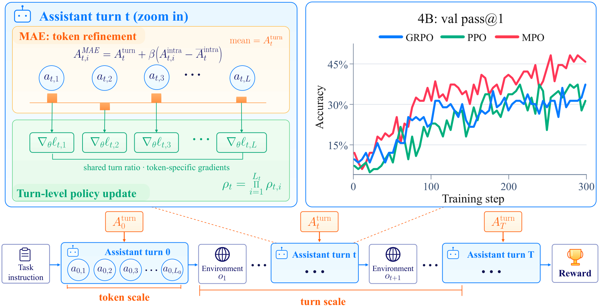

<h1 align="center">Multiscale Policy Optimization</h1>

<p align="center">
  <a href="https://github.com/IQuestLab/Multiscale-Policy-Optimization"></a>
  <a href="https://arxiv.org/abs/2610.35013"></a>
  <a href="https://huggingface.co/papers/2610.35013"></a>
</p>

Multiscale Policy Optimization for multi-turn search agents, built on [verl](https://github.com/volcengine/verl).



*Overview of MPO. MAE refines shared turn advantages into token-level credit
while preserving each turn's mean. The policy update combines a shared
complete-turn importance ratio with token-specific gradients. Top right:
validation pass@1 during 4B training.*

## Installation

Use Python 3.10 and a CUDA environment compatible with the source stack:
PyTorch 2.7.1/cu128, SGLang 0.4.10.post2, Megatron-Core 0.13.1, mbridge 0.15.1,
Transformer Engine 2.5.0, FlashAttention 2.7.4.post1, and FlashInfer 0.2.6.post1.
The original runs used 80 GB GPUs. GPU requirements depend on model size,
parallelism, and token budgets; the default launcher requests one node with eight GPUs.

Install the CUDA stack in the order described in `requirements-cuda.txt`, including
Apex built against the same PyTorch/CUDA installation. Then install this project:

```bash
python -m pip install -e .
```

The CUDA requirements are a reference environment, not a universal wheel install.
Do not install incompatible SGLang/PyTorch extras over this stack. Full GPU training must be validated on your cluster.

## Prepare the question data

The only question dataset is the official
[Tevatron/browsecomp-plus](https://huggingface.co/datasets/Tevatron/browsecomp-plus).
Its upstream split is named `test`. We partition those questions into **747 training
questions and 83 held-out validation questions**. The exact ordered IDs from the
MPO experiments are committed in `data/splits/bcp_plus.json`.
This is a local train/validation partition, not an additional official benchmark split.

```bash
python -m mpo.prepare_data --output-dir data/bcp
export DATA_DIR="$PWD/data/bcp"
```

The command downloads the official questions and writes `train.parquet`,
`validation.parquet`, and `provenance.json`. It records the resolved dataset revision
and split hash and rejects missing, duplicate, or unexpected query IDs.
Prepared records include the research prompt, question, answer, and reward metadata;
source evidence documents are not copied into the model prompt.
For an offline official question parquet, use `--questions-file /path/to/questions.parquet`.

## Download the RAG corpus and build its index

Download the full fixed document collection from
[Tevatron/browsecomp-plus-corpus](https://huggingface.co/datasets/Tevatron/browsecomp-plus-corpus):

```bash
python -m mpo.download_corpus --output "$DATA_DIR/corpus.parquet"
export RETRIEVER_MODEL_PATH=/path/to/Qwen3-Embedding-8B

python -m retrieval.build_index \
  --corpus_file "$DATA_DIR/corpus.parquet" \
  --model "$RETRIEVER_MODEL_PATH" \
  --device cuda:0 --batch_size 4 --max_doc_length 8192 \
  --output "$DATA_DIR/dense_index.pkl"

bash scripts/start_retrieval.sh
```

The document corpus is separate from question labels. Retrieve against the entire
corpus for both training and validation. The download script records the corpus
revision. Model weights can be downloaded from
[Qwen/Qwen3-Embedding-8B](https://huggingface.co/Qwen/Qwen3-Embedding-8B)
using the Hugging Face Hub; pass its local directory as `RETRIEVER_MODEL_PATH`.
Neither model weights nor document contents are bundled in this repository.

For a multi-GPU offline index build, use `torchrun --standalone --nproc_per_node=8
-m retrieval.build_index` with the same corpus/model/output arguments.
Run retrieval on separate GPUs from training. The service exposes `GET /health`,
`POST /retrieve`, and `POST /get_doc` on port 8000. Set `RAG_DEVICE=auto` to shard
the query encoder over the visible GPUs after building the index.

## Configure reward judging and start Ray

The reward judges the final submitted answer against the reference answer with an
OpenAI-compatible chat-completions service. Training and validation share the same
judge implementation. Service failures or unparseable verdicts abort the run rather
than becoming incorrect model answers.

Copy the template below to a private absolute path that exists on every Ray node:

```dotenv
BCP_JUDGE_API_BASE=https://your-judge-service/v1
BCP_JUDGE_MODEL=your-judge-model
BCP_JUDGE_API_KEY=your-api-key
```

```bash
export BCP_JUDGE_ENV_FILE=/absolute/shared/path/judge.env
export MODEL_PATH=/path/to/Qwen3-4B-Thinking-2507
export RAG_URL=http://retriever-host:8000
```

Keep credentials outside the repository. The launcher forwards the environment-file
path to workers; it does not insert API keys into printed Hydra configuration.
Alternatively, set the three judge variables on every node **before** starting Ray.
Use the same judge model and generation settings for comparable runs.

Activate the same environment on every node and expose the repository at the same
absolute path. For one training node:

```bash
ray start --head --port=6379 --num-gpus=8
```

For multiple nodes, start the head with `--node-ip-address=<head-ip>` and start each
worker with `ray start --address=<head-ip>:6379 --num-gpus=8`.
Set `N_NODE` to the total training-node count. Run the driver only on the head.
Every node must have access to the model, prepared data, checkpoint directories,
judge configuration, and retrieval service. The launcher checks node count,
retrieval health, and judge configuration before starting.

## Value pretraining and MPO training

```bash
# Stage 1: fit the value function with a frozen actor (50 steps by default).
VP_STEPS=50 bash scripts/pretrain_value.sh

# Stage 2: initialize the critic and update actor + critic with MPO.
export CRITIC_INIT_FROM_PATH="$PWD/checkpoints/mpo_value_pretrain/global_step_50"
bash scripts/train_mpo.sh
```

The stage-1 checkpoint is an initialization for the critic, not an actor resume.
The default critic loss uses assistant tokens and terminal-return targets.
Both stages keep actor/critic/reference model parallelism aligned.
The default TP is 2; set `ACTOR_TP`, `ACTOR_PP`, `ACTOR_CP`, `ROLLOUT_TP`,
`N_NODE`, and `N_GPU_PER_NODE` for your hardware. Keep the value-pretraining
and MPO critic checkpoint topology compatible.

Common settings are `TRAIN_BATCH_SIZE=32`, `N_RESP=8`, `MAX_ASSISTANT_TURNS=20`,
`MAX_RESPONSE_LENGTH=32768`, `GAE_LAM=0.8`, `INTRA_TURN_LAM=0.95`, and
`INTRA_TURN_BETA=1.0`. MAE combines turn-level GAE (λ = 0.8) with a centered
intra-turn correction (λ = 0.95, β = 1), using Monte Carlo critic targets
(`algorithm.lam_critic=1.0`). The rollout uses `search`, `open_page`, and `finish`;
tool observations are excluded from the assistant policy loss.
MPO uses `actor_rollout_ref.actor.policy_loss.loss_mode=turn_is`: each assistant
turn shares the product of its token importance ratios, while stop-gradient
preserves each token's own MAE advantage and score gradient. Turns use the same
contiguous assistant-token spans as MAE; tool observations and padding are excluded.
The clipped surrogate is averaged over valid assistant tokens. Turn log-ratios
are bounded to [-20, 20] for numerical stability. For the token-IS ablation, pass
`actor_rollout_ref.actor.policy_loss.loss_mode=vanilla` (the inherited vanilla
implementation also supports dual clipping).

Shell environment variables control hardware and run settings; trailing Hydra
overrides can change individual configuration fields.

```bash
# Inspect the command without starting Ray, retrieval, or training.
DRY_RUN=1 MODEL_PATH=/path/to/model CRITIC_INIT_FROM_PATH=/path/to/global_step_50 \
  bash scripts/train_mpo.sh
```

Checkpoints go to `checkpoints/<experiment>/`, rollout/validation JSONL to
`outputs/<experiment>/`, and TensorBoard events to `tensorboard_log/<experiment>/`.
Set `EXPERIMENT_NAME` for a distinct run or `RUN_LOCAL_DIR` for an alternative
checkpoint directory. Model, dataset, cache, and output files are ignored by Git.

## Validate only on the 83 held-out BCP questions

```bash
CHECKPOINT_PATH="$PWD/checkpoints/mpo_train/global_step_100" \
  bash scripts/validate_bcp.sh
```

This loads the trained actor and critic from the MPO checkpoint, reuses the training
search rollout and reward implementation, and runs validation without updates.
Default validation is greedy, one trajectory per question. It uses only
`$DATA_DIR/validation.parquet`; it does not add other benchmark suites.
Judge verdicts, generated responses, and per-question rewards are saved under
`outputs/mpo_validate/validation/`, with aggregate validation metrics in the console
and TensorBoard. The critic is retained because evaluation reuses the training stack.

## Code Structure

| Path | Purpose |
| --- | --- |
| `mpo/` | BCP-Plus data preparation, corpus download, prompts, and cluster preflight |
| `retrieval/` | Dense index construction and retrieval service |
| `configs/` | MPO training configuration and search tool schemas |
| `scripts/` | Value pretraining, MPO training, retrieval, and BCP validation launchers |
| `verl/experimental/agent_loop/tool_agent_loop.py` | Multi-turn search rollout |
| `verl/utils/reward_score/bc_p_llm_judge.py` | BCP-Plus answer reward |
| `verl/trainer/ppo/core_algos.py` | MAE advantage and return computation |

## Citation

If you find this work useful or enjoy using MPO, please consider citing our paper:
[Multiscale Policy Optimization for Long-Horizon LLM Agents](https://arxiv.org/abs/2610.35013).

```bibtex
@misc{ren2026multiscalepolicyoptimization,
  title         = {Multiscale Policy Optimization for Long-Horizon {LLM} Agents},
  author        = {Tao Ren and Hui Yang and Jia Deng and Tingyang Chen and Qiyao Wang and Shuo Tang and Ziyang Zeng and Yuhua Jiang and Guanghao Li and Huatong Song and Yining Li and Yifan Luo and Kunbao Ding and Feng Chang and Chuan Hao and Ran Tao and Bryan Dai and Jiafeng Liang and Jinyang Jiang},
  year          = {2026},
  eprint        = {2610.35013},
  archivePrefix = {arXiv},
  primaryClass  = {cs.AI},
  url           = {https://arxiv.org/abs/2610.35013}
}
```
