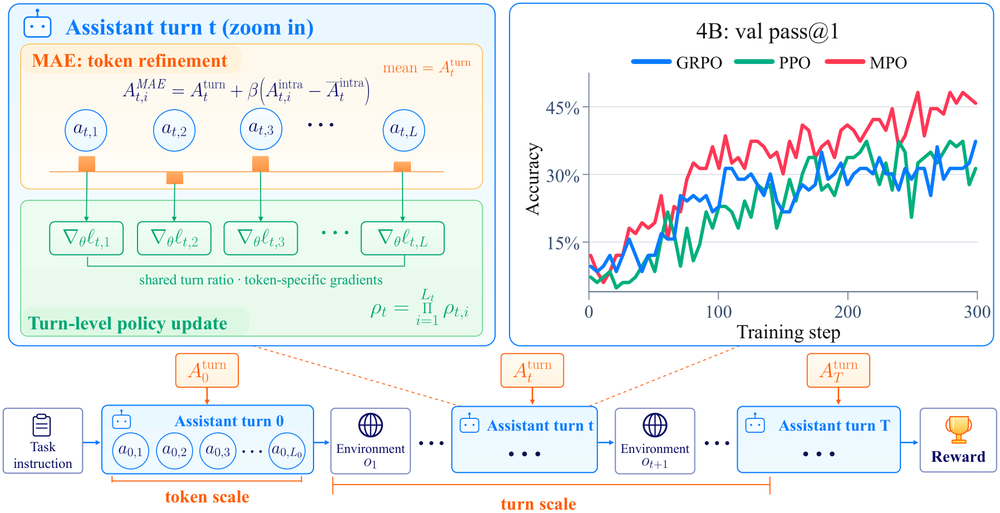

<h1 align="center">Multiscale Policy Optimization</h1>

<p align="center">
  <a href="https://github.com/IQuestLab/Multiscale-Policy-Optimization"></a>
  <a href="https://arxiv.org/abs/2610.35013"></a>
  <a href="https://huggingface.co/papers/2610.35013"></a>
</p>

Multiscale Policy Optimization for multi-turn search agents, built on [verl](https://github.com/volcengine/verl).



*MAE refines shared turn advantages into token-level credit while preserving each
turn's mean; MPO combines a turn-level importance ratio with token-level gradients.*

## Installation

Use Python 3.10 and a compatible CUDA environment. Install the stack in
[`requirements-cuda.txt`](requirements-cuda.txt) in the listed order, including
Apex built against the same PyTorch/CUDA installation, then install the project:

```bash
python -m pip install -e .
```

GPU training requires a working cluster environment; the default launchers use
one node with eight GPUs.

## Prepare the question data

We use the official [Tevatron/browsecomp-plus](https://huggingface.co/datasets/Tevatron/browsecomp-plus)
questions. The committed [split](data/splits/bcp_plus.json) divides them into
747 training and 83 held-out validation questions (not an official benchmark split).

```bash
python -m mpo.prepare_data --output-dir data/bcp
export DATA_DIR="$PWD/data/bcp"
```

This writes `train.parquet` and `validation.parquet`. For an offline question
file, add `--questions-file /path/to/questions.parquet`.

## Download the RAG corpus and build its index

Use the complete [BrowseComp-Plus corpus](https://huggingface.co/datasets/Tevatron/browsecomp-plus-corpus)
for both training and validation. Download
[Qwen3-Embedding-8B](https://huggingface.co/Qwen/Qwen3-Embedding-8B) separately
and set `RETRIEVER_MODEL_PATH` to its local directory.

```bash
python -m mpo.download_corpus --output "$DATA_DIR/corpus.parquet"
export RETRIEVER_MODEL_PATH=/path/to/Qwen3-Embedding-8B

python -m retrieval.build_index \
  --corpus_file "$DATA_DIR/corpus.parquet" \
  --model "$RETRIEVER_MODEL_PATH" \
  --device cuda:0 --batch_size 4 --max_doc_length 8192 \
  --output "$DATA_DIR/dense_index.pkl"

bash scripts/start_retrieval.sh
```

Run retrieval on GPUs separate from training; set `RAG_URL` below if the service
is not on the training node.

## Configure reward judging and start Ray

The answer judge uses an OpenAI-compatible chat-completions service. Create a
private environment file accessible on every Ray node:

```dotenv
BCP_JUDGE_API_BASE=https://your-judge-service/v1
BCP_JUDGE_MODEL=your-judge-model
BCP_JUDGE_API_KEY=your-api-key
```

Point the launchers at the judge file and the local policy model:

```bash
export BCP_JUDGE_ENV_FILE=/absolute/shared/path/judge.env
export MODEL_PATH=/path/to/Qwen3-4B-Thinking-2507
export RAG_URL=http://retriever-host:8000
```

Keep credentials outside the repository. Start Ray on the training node:

```bash
ray start --head --port=6379 --num-gpus=8
```

For multiple nodes, connect workers to the head and set `N_NODE` accordingly;
run the driver on the head. Model, data, checkpoints, judge file, and retrieval
service must be accessible from the workers.

## Value pretraining and MPO training

The launchers contain the training defaults. Stage 2 initializes its critic from
the stage-1 checkpoint (it does not resume the actor):

```bash
# Stage 1: pretrain the value function.
bash scripts/pretrain_value.sh

# Stage 2: train with MPO.
export CRITIC_INIT_FROM_PATH="$PWD/checkpoints/mpo_value_pretrain/global_step_50"
bash scripts/train_mpo.sh
```

To inspect the generated training command without running it:

```bash
DRY_RUN=1 MODEL_PATH=/path/to/model CRITIC_INIT_FROM_PATH=/path/to/global_step_50 \
  bash scripts/train_mpo.sh
```

Change hardware or experiment settings via environment variables, or pass Hydra
overrides to the launchers. Keep the critic checkpoint topology compatible between
stages. Checkpoints are saved under `checkpoints/<experiment>/`, trajectories under
`outputs/<experiment>/`, and TensorBoard logs under `tensorboard_log/<experiment>/`.

## Validate on the 83 held-out questions

```bash
CHECKPOINT_PATH="$PWD/checkpoints/mpo_train/global_step_100" \
  bash scripts/validate_bcp.sh
```

Validation reuses the training search rollout and judge, with no model updates.
Results are written to `outputs/mpo_validate/validation/`.

## Code Structure

| Path | Purpose |
| --- | --- |
| `mpo/` | BCP-Plus data preparation, corpus download, prompts, and cluster preflight |
| `retrieval/` | Dense index construction and retrieval service |
| `configs/` | MPO training configuration and search tool schemas |
| `scripts/` | Value pretraining, MPO training, retrieval, and BCP validation launchers |
| `verl/experimental/agent_loop/tool_agent_loop.py` | Multi-turn search rollout |
| `verl/utils/reward_score/bc_p_llm_judge.py` | BCP-Plus answer reward |
| `verl/trainer/ppo/core_algos.py` | MAE advantage and return computation |

## Citation

If you find this work useful, please cite
[Multiscale Policy Optimization for Long-Horizon LLM Agents](https://arxiv.org/abs/2610.35013).

```bibtex
@misc{ren2026multiscalepolicyoptimization,
  title         = {Multiscale Policy Optimization for Long-Horizon {LLM} Agents},
  author        = {Tao Ren and Hui Yang and Jia Deng and Tingyang Chen and Qiyao Wang and Shuo Tang and Ziyang Zeng and Yuhua Jiang and Guanghao Li and Huatong Song and Yining Li and Yifan Luo and Kunbao Ding and Feng Chang and Chuan Hao and Ran Tao and Bryan Dai and Jiafeng Liang and Jinyang Jiang},
  year          = {2026},
  eprint        = {2610.35013},
  archivePrefix = {arXiv},
  primaryClass  = {cs.AI},
  url           = {https://arxiv.org/abs/2610.35013}
}
```
